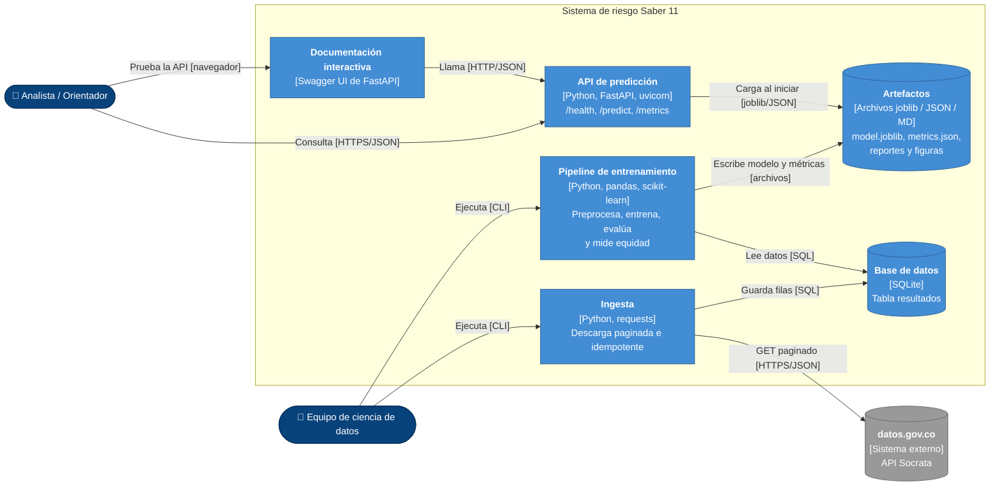

# Proyecto final: Predicción de riesgo de bajo desempeño en Saber 11

> Product concept de Machine Learning — Teoría de la Computación, Universidad de La Salle (2026-2).
> Grupo 3: Camilo Rivera Quintero (`dev_crivera52`), Daniel Charry (`dev_dcharry55`), Richard Caicedo (`dev_rcaicedo05`).

## Tabla de contenido
1. [Problema y contexto](#1-problema-y-contexto)
2. [Alcance: qué hará y qué no hará](#2-alcance-qué-hará-y-qué-no-hará)
3. [Datos](#3-datos)
4. [Arquitectura](#4-arquitectura)
5. [Decisiones de arquitectura (ADR)](#5-decisiones-de-arquitectura-adr)
6. [Modelo](#6-modelo)
7. [Calidad y evaluación](#7-calidad-y-evaluación)
8. [Análisis ético](#8-análisis-ético)
9. [Riesgos técnicos](#9-riesgos-técnicos)
10. [Cómo ejecutar](#10-cómo-ejecutar)
11. [Estructura del repositorio](#11-estructura-del-repositorio)
12. [Conclusiones y recomendaciones](#12-conclusiones-y-recomendaciones)
13. [Glosario](#13-glosario)
14. [Referencias](#14-referencias)
15. [Evidencias](#15-evidencias)

---

## 1. Problema y contexto
*Responsable: Camilo*

Las secretarías de educación y los equipos de orientación de los colegios necesitan focalizar programas de refuerzo **antes** de la prueba Saber 11. Hoy esa focalización se hace de forma reactiva, cuando ya se conocen los resultados.

Este proyecto propone un modelo de clasificación que, a partir de información de contexto disponible antes de la prueba (características del colegio y condiciones del hogar), estima el **riesgo de bajo desempeño** en Saber 11, para apoyar decisiones **agregadas** de asignación de recursos.

- **Pregunta:** ¿qué tan bien puede un modelo sencillo identificar contextos con riesgo de bajo desempeño usando solo variables previas a la prueba?
- **Variable objetivo:** `riesgo_bajo_desempeno` (1 si `punt_global` < 234, el percentil 25 del periodo).

### User persona

| Persona | Contexto | Necesidad | Cómo usa el sistema |
|---|---|---|---|
| **Marta, analista de la Secretaría de Educación de Bogotá** | Reparte cada año un presupuesto limitado de tutorías entre cientos de colegios oficiales. | Saber con anticipación dónde se concentra el riesgo para no asignar recursos "a ciegas". | Consulta el riesgo agregado y las métricas del modelo, incluidas las de equidad, antes de decidir. |
| **Jorge, orientador de un colegio oficial en Kennedy** | Acompaña a más de 300 estudiantes de grado 11 con poco tiempo. | Priorizar talleres de preparación y conversaciones con familias. | Consulta el riesgo de perfiles de contexto típicos de su colegio para planear acompañamiento grupal, no para etiquetar a estudiantes. |
| **Equipo de ciencia de datos** | Mantiene el modelo. | Reentrenar con nuevos periodos y vigilar que el modelo no sea injusto con ningún grupo. | Ejecuta el pipeline y revisa los reportes de métricas y equidad. |

## 2. Alcance: qué hará y qué no hará
*Responsable: Camilo*

| El sistema **SÍ** | El sistema **NO** |
|---|---|
| Descarga y almacena resultados Saber 11 del periodo y región configurados | Toma decisiones individuales sobre estudiantes (becas, admisión, sanciones) |
| Entrena y evalúa un modelo de clasificación binaria | Predice el puntaje exacto |
| Expone una API para consultar el riesgo de un perfil de contexto | Usa datos personales identificables |
| Reporta métricas globales y por grupo poblacional | Usa los puntajes de la prueba como variables de entrada |

**Supuestos y restricciones**
- Alcance de datos: periodo `20224`, colegios ubicados en Bogotá, configurable en `config/config.yaml`.
- Solo herramientas open source; ejecución local, sin servicios en la nube.
- Es un *product concept*: no incluye autenticación, interfaz gráfica propia ni despliegue productivo. Se documentan como evolución futura.

## 3. Datos

*Responsable: Daniel*

- **Fuente:** [Resultados únicos Saber 11 — datos.gov.co](https://www.datos.gov.co/Educaci-n/Resultados-nicos-Saber-11/kgxf-xxbe), API Socrata `kgxf-xxbe`.
- **Entidad:** Instituto Colombiano para la Evaluación de la Educación (ICFES).
- **Licencia:** Creative Commons Attribution-ShareAlike 4.0 International.
- **Alcance:** periodo `20224`, colegios ubicados en Bogotá.
- **Registros:** 152.584 filas descargadas, que corresponden a **76.253 estudiantes únicos**. Las otras 76.331 filas son copias idénticas y se eliminan en `clean()`.
- **Tipo de datos:** tabulares. La API entrega todas las columnas como texto.

### Objetivo del modelo
Clasificación binaria. `riesgo_bajo_desempeno` vale 1 si `punt_global` es menor que **234**, el percentil 25 del periodo. El 24,57 % de los estudiantes queda en la clase 1.

### Diccionario de variables
| Variable | Descripción | Tipo | Uso |
|---|---|---|---|
| `cole_area_ubicacion` | Área del colegio: urbana o rural | Categórica | Entrada, sensible |
| `cole_bilingue` | Colegio bilingüe | Categórica | Entrada |
| `cole_calendario` | Calendario A, B u otro | Categórica | Entrada |
| `cole_caracter` | Académico, técnico o ambos | Categórica | Entrada |
| `cole_genero` | Colegio mixto, femenino o masculino | Categórica | Entrada |
| `cole_jornada` | Jornada del colegio | Categórica | Entrada |
| `cole_naturaleza` | Oficial o no oficial | Categórica | Entrada, sensible |
| `estu_genero` | Género del estudiante | Categórica | Entrada, sensible |
| `fami_cuartoshogar` | Cuartos del hogar | Categórica | Entrada |
| `fami_educacionmadre` | Educación de la madre | Categórica | Entrada |
| `fami_educacionpadre` | Educación del padre | Categórica | Entrada |
| `fami_estratovivienda` | Estrato de la vivienda | Categórica | Entrada, sensible |
| `fami_personashogar` | Personas en el hogar | Categórica | Entrada |
| `fami_tieneautomovil` | El hogar tiene automóvil | Categórica | Entrada |
| `fami_tienecomputador` | El hogar tiene computador | Categórica | Entrada |
| `fami_tieneinternet` | El hogar tiene internet | Categórica | Entrada |
| `fami_tienelavadora` | El hogar tiene lavadora | Categórica | Entrada |
| `edad` | Edad en el año de la prueba, calculada desde `estu_fechanacimiento` | Numérica | Entrada |
| `estu_consecutivo` | Identificador del registro | Texto | Solo para quitar duplicados |
| `punt_global` | Puntaje global de la prueba | Numérica | Solo para construir el target |

Las columnas `punt_*`, `desemp_*` y `percentil_*` nunca son entrada del modelo, porque son el resultado de la prueba.

### Ejemplo de los datos
| cole_naturaleza   | cole_area_ubicacion   | cole_jornada   | estu_genero   | fami_estratovivienda   | fami_tieneinternet   |   edad |   punt_global |
|:------------------|:----------------------|:---------------|:--------------|:-----------------------|:---------------------|-------:|--------------:|
| OFICIAL           | URBANO                | UNICA          | F             | Estrato 2              | Si                   |     18 |           262 |
| OFICIAL           | URBANO                | UNICA          | M             | Estrato 2              | No                   |     18 |           239 |
| OFICIAL           | URBANO                | TARDE          | F             | Estrato 2              | No                   |     18 |           216 |
| OFICIAL           | URBANO                | UNICA          | F             | Estrato 3              | Si                   |     17 |           186 |
| OFICIAL           | URBANO                | MAÑANA         | F             | Estrato 1              | No                   |     17 |           284 |

### Resumen del EDA
El análisis completo está en [`notebooks/01_eda.ipynb`](notebooks/01_eda.ipynb).

- **Duplicados:** la mitad de las filas son copias. Sin quitarlas, un mismo estudiante podría quedar en train y en test.
- **Nulos:** los puntajes casi no tienen vacíos. Los mayores están en `cole_bilingue` (18,5 %) y `cole_caracter` (4,6 %), y se imputan dentro del `Pipeline`.
- **Relación con el riesgo:** va de 12,7 % en estrato 4 a 36,9 % en estrato 1; de 4,7 % con madre con postgrado a 59,6 % con madre sin educación; y es de 31,2 % en colegios oficiales frente a 15,5 % en no oficiales.
- **Grupos pequeños:** zona rural (663), estrato 6 (417) y "Sin Estrato" (556) dan estimaciones menos estables.


## 4. Arquitectura
*Responsable: Camilo*

### 4.1 Estilo arquitectónico
Arquitectura **en capas**: cada capa tiene una sola responsabilidad y solo usa la capa inmediatamente inferior, a través de las interfaces de [`docs/arquitectura/contratos.md`](docs/arquitectura/contratos.md). La justificación está en el [ADR-001](docs/adr/0001-lenguaje-framework-estilo.md).

| Capa | Responsabilidad | Código |
|---|---|---|
| Datos | Descargar y almacenar los resultados | `src/saber11/data/` |
| Procesamiento | Limpiar, construir el target, separar y transformar | `src/saber11/features/` |
| Modelo | Entrenar, evaluar y medir equidad | `src/saber11/models/` |
| Servicio | Exponer predicciones y métricas por HTTP | `src/saber11/api/` |
| Presentación | Probar la API desde el navegador | Swagger UI en `/docs` |

### 4.2 Diagrama C4 — Contexto
Usuarios, sistema y fuentes externas de datos. Lo gris y punteado está fuera del alcance actual. Detalle en [`docs/arquitectura/c4-contexto.md`](docs/arquitectura/c4-contexto.md).


### 4.3 Diagrama C4 — Contenedores
Piezas ejecutables y de almacenamiento, con su tecnología. Detalle en [`docs/arquitectura/c4-contenedores.md`](docs/arquitectura/c4-contenedores.md).



### 4.4 C4 — Componentes
Componentes internos del pipeline de entrenamiento y de la API, con el módulo y el responsable de cada uno, en [`docs/arquitectura/c4-componentes.md`](docs/arquitectura/c4-componentes.md). Las firmas de cada componente están en [`docs/arquitectura/contratos.md`](docs/arquitectura/contratos.md).

Por diseño, la API **no** depende de las capas de datos ni de procesamiento: solo usa el `Pipeline` serializado, que ya incluye el preprocesamiento.

### 4.5 Drivers y atributos de calidad
Detalle completo (restricciones, 9 escenarios y tácticas) en [`docs/arquitectura/drivers-calidad.md`](docs/arquitectura/drivers-calidad.md).

**Restricciones principales:** solo open source, ejecución local, datos tabulares de una API pública, modelo básico de ML, 6 días de plazo y solo variables previas a la prueba.

| Atributo | Escenario medible | Táctica principal |
|---|---|---|
| Rendimiento | p95 de `POST /predict` < 300 ms con 10 clientes concurrentes (500 solicitudes) | Modelo cargado una sola vez al iniciar; entrenamiento separado de la predicción |
| Confiabilidad | Entrada inválida → 422 con el campo que falla; 0 % de respuestas 500 | Validación con Pydantic |
| Integridad de datos | Re-ejecutar la ingesta deja el mismo número de filas | Ingesta idempotente |
| Disponibilidad de la fuente | Hasta 3 reintentos por página con timeout de 120 s | Reintentos + copia local de los datos |
| Reproducibilidad | Mismas métricas de test en cualquier equipo | Semilla fija y parámetros en `config.yaml` |
| Validez del modelo | El pipeline falla si una variable de entrada contiene el resultado de la prueba | Lista blanca de variables + preprocesamiento dentro del `Pipeline` |
| Equidad | Brecha de recall > 0,10 entre grupos se reporta y se discute | Métricas por grupo sensible |
| Mantenibilidad | Cambiar de modelo no modifica la API | Contratos entre capas |

## 5. Decisiones de arquitectura (ADR)
Índice en [`docs/adr/`](docs/adr/README.md).

| ADR | Decisión | Responsable | Estado |
|---|---|---|---|
| [001](docs/adr/0001-lenguaje-framework-estilo.md) | Python + FastAPI + arquitectura en capas | Camilo | Aceptada |
| [002](docs/adr/0002-seleccion-modelo.md) | Regresión logística elegida por F1 en validación | Richard | Aceptada |
| [003](docs/adr/0003-almacenamiento-despliegue.md) | SQLite + joblib + uvicorn local | Camilo | Aceptada |
| [004](docs/adr/0004-separacion-datos.md) | Separación 70/15/15 estratificada, sin duplicados | Daniel | Aceptada |

## 6. Modelo
*Responsable: Richard*

TODO: modelo seleccionado, justificación, hiperparámetros, entrenamiento.

## 7. Calidad y evaluación
*Responsables: Richard (métricas), Daniel (separación de datos), Camilo (criterios de aceptación)*

- **Estrategia de separación:** TODO (ver ADR-004).
- **Modelo de referencia (baseline):** TODO.
- **Tabla de métricas:** TODO (Accuracy, Precision, Recall, F1, ROC-AUC vs baseline).
- **Matriz de confusión** e interpretación de VP, FP, VN, FN: TODO.
- **Criterios de aceptación del software:** TODO.

## 8. Análisis ético
*Responsable: Richard*

TODO: resumen; análisis completo en `docs/analisis_etico.md`.

## 9. Riesgos técnicos
*Responsables: todos*

| # | Riesgo | Impacto | Mitigación |
|---|---|---|---|
| R1 | Fuga de información (usar `punt_*` como entrada) | TODO | TODO |
| R2 | Desbalance de clases | TODO | TODO |
| R3 | Sesgo socioeconómico / discriminación por variables *proxy* | TODO | TODO |
| R4 | Sobreajuste del árbol de decisión | TODO | TODO |
| R5 | Volumen de datos y límites de la API | TODO | TODO |

## 10. Cómo ejecutar
```bash
python -m venv .venv && source .venv/bin/activate
pip install -r requirements.txt
pip install -e .
# TODO: comandos de ingesta, entrenamiento, evaluación y API
pytest
```

## 11. Estructura del repositorio
```
├── config/            # Parámetros (periodo, región, umbral, semillas)
├── data/              # raw/ y processed/ (no versionados)
├── docs/
│   ├── adr/           # Architecture Decision Records
│   ├── arquitectura/  # Diagramas C4
│   └── evidencias/    # Capturas y evidencias.pdf
├── models/            # Artefactos entrenados (.joblib)
├── notebooks/         # EDA y experimentos
├── reports/           # Métricas y figuras
├── src/saber11/
│   ├── data/          # Capa de datos: ingesta y almacenamiento
│   ├── features/      # Capa de procesamiento: limpieza y features
│   ├── models/        # Capa de modelo: entrenamiento y evaluación
│   └── api/           # Capa de servicio: FastAPI
└── tests/             # Set de pruebas
```

## 12. Conclusiones y recomendaciones
TODO.

## 13. Glosario
| Término | Definición |
|---|---|
| ADR | *Architecture Decision Record*: registro de una decisión de arquitectura, su contexto y consecuencias. |
| C4 | Modelo para describir arquitectura en cuatro niveles: contexto, contenedores, componentes y código. |
| TODO | — |

## 14. Referencias
- ICFES. *Resultados únicos Saber 11*. datos.gov.co. https://www.datos.gov.co/Educaci-n/Resultados-nicos-Saber-11/kgxf-xxbe
- Brown, S. *The C4 model for visualising software architecture*. https://c4model.com
- Nygard, M. *Documenting Architecture Decisions*. https://cognitect.com/blog/2011/11/15/documenting-architecture-decisions
- TODO: scikit-learn, FastAPI, referencias de ética/equidad.

## 15. Evidencias
Capturas de cada etapa del workflow de ML consolidadas en [`docs/evidencias/evidencias.pdf`](docs/evidencias/).
