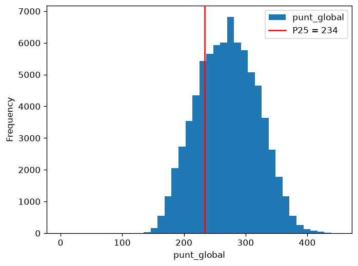
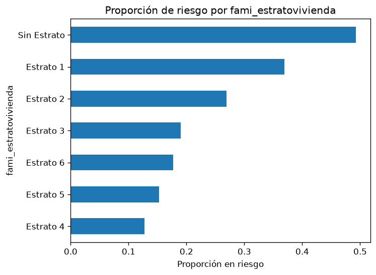
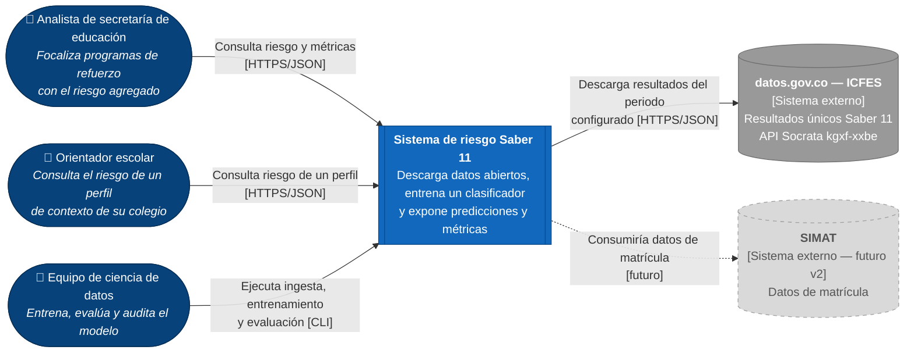
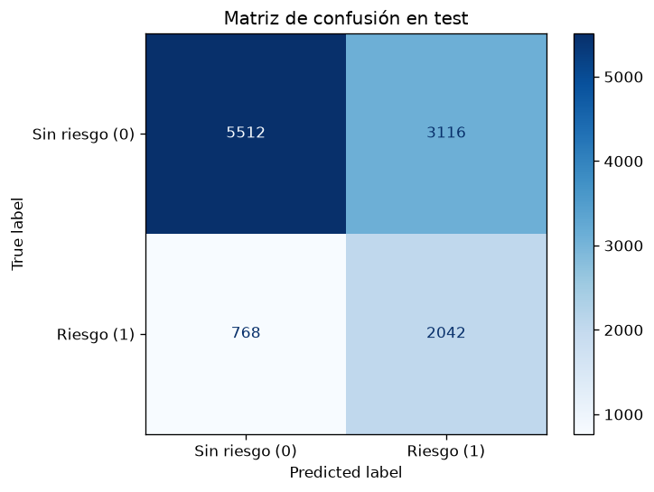

# Proyecto final: Predicción de riesgo de bajo desempeño en Saber 11

> Product concept de Machine Learning — Teoría de la Computación, Universidad de La Salle (2026-2).
> Grupo 3: Camilo Rivera Quintero (`dev_crivera52`), Daniel Charry (`dev_dcharry55`), Richard Caicedo (`dev_rcaicedo05`).

## Tabla de contenido
1. [Problema y contexto](#1-problema-y-contexto)
2. [Alcance: qué hará y qué no hará](#2-alcance-qué-hará-y-qué-no-hará)
3. [Datos](#3-datos)
4. [Arquitectura](#4-arquitectura)
5. [Decisiones de arquitectura (ADR)](#5-decisiones-de-arquitectura-adr)
6. [Modelo](#6-modelo)
7. [Calidad y evaluación](#7-calidad-y-evaluación)
8. [Análisis ético](#8-análisis-ético)
9. [Riesgos técnicos](#9-riesgos-técnicos)
10. [Cómo ejecutar](#10-cómo-ejecutar)
11. [Estructura del repositorio](#11-estructura-del-repositorio)
12. [Conclusiones y recomendaciones](#12-conclusiones-y-recomendaciones)
13. [Glosario](#13-glosario)
14. [Referencias](#14-referencias)
15. [Evidencias](#15-evidencias)

---

## 1. Problema y contexto
*Responsable: Camilo*

Las secretarías de educación y los equipos de orientación de los colegios necesitan focalizar programas de refuerzo **antes** de la prueba Saber 11. Hoy esa focalización se hace de forma reactiva, cuando ya se conocen los resultados.

Este proyecto propone un modelo de clasificación que, a partir de información de contexto disponible antes de la prueba (características del colegio y condiciones del hogar), estima el **riesgo de bajo desempeño** en Saber 11, para apoyar decisiones **agregadas** de asignación de recursos.

- **Pregunta:** ¿qué tan bien puede un modelo sencillo identificar contextos con riesgo de bajo desempeño usando solo variables previas a la prueba?
- **Variable objetivo:** `riesgo_bajo_desempeno` (1 si `punt_global` < 234, el percentil 25 del periodo).

### User persona

| Persona | Contexto | Necesidad | Cómo usa el sistema |
|---|---|---|---|
| **Marta, analista de la Secretaría de Educación de Bogotá** | Reparte cada año un presupuesto limitado de tutorías entre cientos de colegios oficiales. | Saber con anticipación dónde se concentra el riesgo para no asignar recursos "a ciegas". | Consulta el riesgo agregado y las métricas del modelo, incluidas las de equidad, antes de decidir. |
| **Jorge, orientador de un colegio oficial en Kennedy** | Acompaña a más de 300 estudiantes de grado 11 con poco tiempo. | Priorizar talleres de preparación y conversaciones con familias. | Consulta el riesgo de perfiles de contexto típicos de su colegio para planear acompañamiento grupal, no para etiquetar a estudiantes. |
| **Equipo de ciencia de datos** | Mantiene el modelo. | Reentrenar con nuevos periodos y vigilar que el modelo no sea injusto con ningún grupo. | Ejecuta el pipeline y revisa los reportes de métricas y equidad. |

## 2. Alcance: qué hará y qué no hará
*Responsable: Camilo*

| El sistema **SÍ** | El sistema **NO** |
|---|---|
| Descarga y almacena resultados Saber 11 del periodo y región configurados | Toma decisiones individuales sobre estudiantes (becas, admisión, sanciones) |
| Entrena y evalúa un modelo de clasificación binaria | Predice el puntaje exacto |
| Expone una API para consultar el riesgo de un perfil de contexto | Usa datos personales identificables |
| Reporta métricas globales y por grupo poblacional | Usa los puntajes de la prueba como variables de entrada |

**Supuestos y restricciones**
- Alcance de datos: periodo `20224`, colegios ubicados en Bogotá, configurable en `config/config.yaml`.
- Solo herramientas open source; ejecución local, sin servicios en la nube.
- Es un *product concept*: no incluye autenticación, interfaz gráfica propia ni despliegue productivo. Se documentan como evolución futura.

## 3. Datos

*Responsable: Daniel*

- **Fuente:** [Resultados únicos Saber 11 — datos.gov.co](https://www.datos.gov.co/Educaci-n/Resultados-nicos-Saber-11/kgxf-xxbe), API Socrata `kgxf-xxbe`.
- **Entidad:** Instituto Colombiano para la Evaluación de la Educación (ICFES).
- **Licencia:** Creative Commons Attribution-ShareAlike 4.0 International.
- **Alcance:** periodo `20224`, colegios ubicados en Bogotá.
- **Registros:** 152.584 filas descargadas, que corresponden a **76.253 estudiantes únicos**. Las otras 76.331 filas son copias idénticas y se eliminan en `clean()`.
- **Tipo de datos:** tabulares. La API entrega todas las columnas como texto.

### Objetivo del modelo
Clasificación binaria. `riesgo_bajo_desempeno` vale 1 si `punt_global` es menor que **234**, el percentil 25 del periodo. El 24,57 % de los estudiantes queda en la clase 1.

### Diccionario de variables
| Variable | Descripción | Tipo | Uso |
|---|---|---|---|
| `cole_area_ubicacion` | Área del colegio: urbana o rural | Categórica | Entrada, sensible |
| `cole_bilingue` | Colegio bilingüe | Categórica | Entrada |
| `cole_calendario` | Calendario A, B u otro | Categórica | Entrada |
| `cole_caracter` | Académico, técnico o ambos | Categórica | Entrada |
| `cole_genero` | Colegio mixto, femenino o masculino | Categórica | Entrada |
| `cole_jornada` | Jornada del colegio | Categórica | Entrada |
| `cole_naturaleza` | Oficial o no oficial | Categórica | Entrada, sensible |
| `estu_genero` | Género del estudiante | Categórica | Entrada, sensible |
| `fami_cuartoshogar` | Cuartos del hogar | Categórica | Entrada |
| `fami_educacionmadre` | Educación de la madre | Categórica | Entrada |
| `fami_educacionpadre` | Educación del padre | Categórica | Entrada |
| `fami_estratovivienda` | Estrato de la vivienda | Categórica | Entrada, sensible |
| `fami_personashogar` | Personas en el hogar | Categórica | Entrada |
| `fami_tieneautomovil` | El hogar tiene automóvil | Categórica | Entrada |
| `fami_tienecomputador` | El hogar tiene computador | Categórica | Entrada |
| `fami_tieneinternet` | El hogar tiene internet | Categórica | Entrada |
| `fami_tienelavadora` | El hogar tiene lavadora | Categórica | Entrada |
| `edad` | Edad en el año de la prueba, calculada desde `estu_fechanacimiento` | Numérica | Entrada |
| `estu_consecutivo` | Identificador del registro | Texto | Solo para quitar duplicados |
| `punt_global` | Puntaje global de la prueba | Numérica | Solo para construir el target |

Las columnas `punt_*`, `desemp_*` y `percentil_*` nunca son entrada del modelo, porque son el resultado de la prueba.

### Ejemplo de los datos
| cole_naturaleza   | cole_area_ubicacion   | cole_jornada   | estu_genero   | fami_estratovivienda   | fami_tieneinternet   |   edad |   punt_global |
|:------------------|:----------------------|:---------------|:--------------|:-----------------------|:---------------------|-------:|--------------:|
| OFICIAL           | URBANO                | UNICA          | F             | Estrato 2              | Si                   |     18 |           262 |
| OFICIAL           | URBANO                | UNICA          | M             | Estrato 2              | No                   |     18 |           239 |
| OFICIAL           | URBANO                | TARDE          | F             | Estrato 2              | No                   |     18 |           216 |
| OFICIAL           | URBANO                | UNICA          | F             | Estrato 3              | Si                   |     17 |           186 |
| OFICIAL           | URBANO                | MAÑANA         | F             | Estrato 1              | No                   |     17 |           284 |

### Resumen del EDA
El análisis completo está en [`notebooks/01_eda.ipynb`](notebooks/01_eda.ipynb).

- **Duplicados:** la mitad de las filas son copias. Sin quitarlas, un mismo estudiante podría quedar en train y en test.
- **Nulos:** los puntajes casi no tienen vacíos. Los mayores están en `cole_bilingue` (18,5 %) y `cole_caracter` (4,6 %), y se imputan dentro del `Pipeline`.
- **Relación con el riesgo:** va de 12,7 % en estrato 4 a 36,9 % en estrato 1; de 4,7 % con madre con postgrado a 59,6 % con madre sin educación; y es de 31,2 % en colegios oficiales frente a 15,5 % en no oficiales.
- **Grupos pequeños:** zona rural (663), estrato 6 (417) y "Sin Estrato" (556) dan estimaciones menos estables.




## 4. Arquitectura
*Responsable: Camilo*

### 4.1 Estilo arquitectónico
Arquitectura **en capas**: cada capa tiene una sola responsabilidad y solo usa la capa inmediatamente inferior, a través de las interfaces de [`docs/arquitectura/contratos.md`](docs/arquitectura/contratos.md). La justificación está en el [ADR-001](docs/adr/0001-lenguaje-framework-estilo.md).

| Capa | Responsabilidad | Código |
|---|---|---|
| Datos | Descargar y almacenar los resultados | `src/saber11/data/` |
| Procesamiento | Limpiar, construir el target, separar y transformar | `src/saber11/features/` |
| Modelo | Entrenar, evaluar y medir equidad | `src/saber11/models/` |
| Servicio | Exponer predicciones y métricas por HTTP | `src/saber11/api/` |
| Presentación | Probar la API desde el navegador | Swagger UI en `/docs` |

### 4.2 Diagrama C4 — Contexto
Usuarios, sistema y fuentes externas de datos. Lo gris y punteado está fuera del alcance actual. Detalle en [`docs/arquitectura/c4-contexto.md`](docs/arquitectura/c4-contexto.md).



### 4.3 Diagrama C4 — Contenedores
Piezas ejecutables y de almacenamiento, con su tecnología. Detalle en [`docs/arquitectura/c4-contenedores.md`](docs/arquitectura/c4-contenedores.md).


### 4.4 C4 — Componentes
Componentes internos del pipeline de entrenamiento y de la API, con el módulo y el responsable de cada uno, en [`docs/arquitectura/c4-componentes.md`](docs/arquitectura/c4-componentes.md). Las firmas de cada componente están en [`docs/arquitectura/contratos.md`](docs/arquitectura/contratos.md).

Por diseño, la API **no** depende de las capas de datos ni de procesamiento: solo usa el `Pipeline` serializado, que ya incluye el preprocesamiento.

### 4.5 Drivers y atributos de calidad
Detalle completo (restricciones, 9 escenarios y tácticas) en [`docs/arquitectura/drivers-calidad.md`](docs/arquitectura/drivers-calidad.md).

**Restricciones principales:** solo open source, ejecución local, datos tabulares de una API pública, modelo básico de ML, 6 días de plazo y solo variables previas a la prueba.

| Atributo | Escenario medible | Táctica principal |
|---|---|---|
| Rendimiento | p95 de `POST /predict` < 300 ms con 10 clientes concurrentes (500 solicitudes) | Modelo cargado una sola vez al iniciar; entrenamiento separado de la predicción |
| Confiabilidad | Entrada inválida → 422 con el campo que falla; 0 % de respuestas 500 | Validación con Pydantic |
| Integridad de datos | Re-ejecutar la ingesta deja el mismo número de filas | Ingesta idempotente |
| Disponibilidad de la fuente | Hasta 3 reintentos por página con timeout de 120 s | Reintentos + copia local de los datos |
| Reproducibilidad | Mismas métricas de test en cualquier equipo | Semilla fija y parámetros en `config.yaml` |
| Validez del modelo | El pipeline falla si una variable de entrada contiene el resultado de la prueba | Lista blanca de variables + preprocesamiento dentro del `Pipeline` |
| Equidad | Brecha de recall > 0,10 entre grupos se reporta y se discute | Métricas por grupo sensible |
| Mantenibilidad | Cambiar de modelo no modifica la API | Contratos entre capas |

## 5. Decisiones de arquitectura (ADR)
Índice en [`docs/adr/`](docs/adr/README.md).

| ADR | Decisión | Responsable | Estado |
|---|---|---|---|
| [001](docs/adr/0001-lenguaje-framework-estilo.md) | Python + FastAPI + arquitectura en capas | Camilo | Aceptada |
| [002](docs/adr/0002-seleccion-modelo.md) | Regresión logística elegida por F1 en validación | Richard | Aceptada |
| [003](docs/adr/0003-almacenamiento-despliegue.md) | SQLite + joblib + uvicorn local | Camilo | Aceptada |
| [004](docs/adr/0004-separacion-datos.md) | Separación 70/15/15 estratificada, sin duplicados | Daniel | Aceptada |

## 6. Modelo

*Responsable: Richard*

Se eligió **regresión logística** porque es un modelo básico, interpretable y rápido, y obtuvo el mejor F1 y el mejor ROC-AUC en validación. La comparación completa está en el [ADR-002](docs/adr/0002-seleccion-modelo.md).

- **Propósito:** estimar el riesgo de bajo desempeño de un perfil de contexto para apoyar la planeación agregada de refuerzos.
- **Hiperparámetros:** `LogisticRegression(max_iter=1000, class_weight="balanced")`. El peso balanceado compensa que solo el 24,57 % de los casos sea clase 1.
- **Preprocesamiento:** categóricas con imputación por moda y `OneHotEncoder(handle_unknown="ignore")`; `edad` con imputación por mediana y `StandardScaler`. Va dentro del `Pipeline` y se ajusta solo con train.
- **Entrenamiento:** 53.377 estudiantes y 75 columnas tras la codificación.
- **Qué mira el modelo:** los coeficientes más altos están en jornada nocturna y sabatina, y en padres sin educación. Los más bajos, en jornada completa y padres con postgrado. Son asociaciones, no causas.

## 7. Calidad y evaluación

*Responsables: Richard (métricas), Daniel (separación de datos), Camilo (criterios de aceptación)*

- **Estrategia de separación:** 70/15/15 estratificada por el target, con `random_state=42`, sin estudiantes repetidos: 53.377 en train, 11.438 en validación y 11.438 en test, con 24,57 % de clase 1 en cada uno ([ADR-004](docs/adr/0004-separacion-datos.md)).
- **Modelo de referencia (baseline):** `DummyClassifier(strategy="most_frequent")`, que siempre predice "sin riesgo".

### Métricas en test
| Modelo | Accuracy | Precision | Recall | F1 | ROC-AUC |
|---|---|---|---|---|---|
| Baseline | 0,7543 | 0,0000 | 0,0000 | 0,0000 | 0,5000 |
| **Regresión logística** | 0,6604 | 0,3959 | 0,7267 | **0,5126** | 0,7539 |
| Árbol de decisión | 0,6299 | 0,3736 | 0,7480 | 0,4983 | 0,7420 |

| Métrica | Valor | Qué significa aquí |
|---|---|---|
| Accuracy | 0,6604 | Acierta en 66 de cada 100 casos. Es menor que la del baseline porque el baseline nunca detecta riesgo: por eso esta métrica no sirve sola. |
| Precision | 0,3959 | De cada 100 alertas, cerca de 40 son estudiantes realmente en riesgo. |
| Recall | 0,7267 | Detecta cerca de 73 de cada 100 estudiantes en riesgo. |
| F1 | 0,5126 | Equilibra precision y recall. Es la métrica de selección. |
| ROC-AUC | 0,7539 | Distingue entre clases mejor que el azar (0,5), con capacidad moderada. |

### Matriz de confusión
| | Predicho: sin riesgo | Predicho: riesgo |
|---|---|---|
| **Real: sin riesgo** | VN = 5.512 | FP = 3.116 |
| **Real: riesgo** | FN = 768 | VP = 2.042 |



- **Verdaderos positivos (2.042):** estudiantes en riesgo que el modelo detecta.
- **Verdaderos negativos (5.512):** estudiantes sin riesgo que el modelo descarta bien.
- **Falsos positivos (3.116):** estudiantes sin riesgo marcados como en riesgo. Su costo es usar recursos donde no hacían falta y etiquetar sin razón.
- **Falsos negativos (768):** estudiantes en riesgo que no se detectan. Es el error más grave para este propósito, porque se quedan sin apoyo.

### Criterios de aceptación del software
Cada criterio viene de un escenario de [`drivers-calidad.md`](docs/arquitectura/drivers-calidad.md).

| Criterio | Medida | Resultado | Evidencia |
|---|---|---|---|
| El modelo supera al baseline | F1 mayor que el del baseline | ✅ 0,5126 frente a 0 | `reports/metrics.json` |
| QA1 Rendimiento | p95 < 300 ms con 10 clientes y 500 solicitudes | ✅ 43,95 ms, 0 errores | `reports/latencia.json` |
| QA2 Confiabilidad | Entrada inválida → 422 con el campo que falla | ✅ | `tests/test_api.py` |
| QA3 Integridad | Mismas filas al repetir la carga; 0 duplicados tras `clean()` | ✅ 152.584 filas en ambas ejecuciones | `tests/test_data.py`, notebook de EDA |
| QA5 Reproducibilidad | Métricas de test idénticas | ✅ `metrics.json` idéntico en dos ejecuciones | Comparación de archivos |
| QA6 Validez | `ValueError` si entra una variable con fuga | ✅ | `tests/test_data.py` |
| QA7 Equidad | Reportar brechas de recall > 0,10 | ⚠️ Reportadas: las 4 variables superan el criterio | `reports/equidad.md` |
| QA8 Mantenibilidad | La API no depende de datos ni de procesamiento | ✅ | `tests/test_api.py` |
| QA9 Privacidad | Sin identificadores ni puntajes en la API | ✅ | `tests/test_api.py` |

## 8. Análisis ético

*Responsable: Richard*

El análisis completo está en [`docs/analisis_etico.md`](docs/analisis_etico.md).

- **Sesgos:** los datos cubren un solo periodo de Bogotá, y variables como el estrato o la educación de los padres son aproximaciones del nivel socioeconómico.
- **Equidad:** las cuatro variables auditadas superan la brecha de recall de 0,10: estrato (0,41), naturaleza del colegio (0,24), área (0,14) y género (0,14). En estrato 1, el 71 % de quienes no están en riesgo queda marcado como en riesgo.
- **Variables sensibles:** quitarlas casi no cambia el F1 (0,5129 frente a 0,5126) y reduce las brechas de género y área, pero no las de estrato y naturaleza, porque otras variables actúan como *proxies*.
- **Privacidad:** los datos son abiertos y anónimos, pero cruzarlos podría permitir reidentificar personas. La API no acepta identificadores.
- **Impacto social:** usar el modelo sobre individuos podría estigmatizar a estudiantes y colegios.
- **Uso responsable:** sirve para planear apoyos de forma agregada y con revisión humana. **No debe usarse para decisiones individuales.**

## 9. Riesgos técnicos

*Responsables: todos*

| # | Riesgo | Impacto | Mitigación |
|---|---|---|---|
| R1 | Fuga de información (usar `punt_*` como entrada o repetir estudiantes entre conjuntos) | Alto: métricas infladas que no se sostienen en uso real. Con duplicados, el F1 en validación subía de 0,504 a 0,522 | Lista blanca `FEATURES`, `ValueError` ante prefijos prohibidos, duplicados eliminados antes de separar y preprocesamiento ajustado solo con train |
| R2 | Desbalance de clases (24,57 % de clase 1) | Alto: un modelo trivial logra 75 % de accuracy sin detectar a nadie | Selección por F1, `class_weight="balanced"`, separación estratificada y comparación con baseline |
| R3 | Sesgo socioeconómico / discriminación por variables *proxy* | Alto: brecha de recall de 0,41 por estrato y muchos falsos positivos en grupos vulnerables | Métricas por grupo, comparación sin variables sensibles y uso limitado a decisiones agregadas |
| R4 | Sobreajuste del árbol de decisión | Medio: un árbol profundo memoriza train y pierde capacidad de generalizar | Límites de `max_depth` y `min_samples_leaf`, selección en validación y test intacto. Se eligió el modelo lineal |
| R5 | Volumen de datos y límites de la API | Medio: descargas lentas o fallidas | Paginación de 50.000 filas, 3 reintentos con timeout de 120 s y copia local en CSV y SQLite |

## 10. Cómo ejecutar

Requiere Python 3.11 o superior. Ejecuta los comandos desde la raíz del repositorio.

**1. Instalar**
```bash
python -m venv .venv
source .venv/bin/activate      # Windows (PowerShell): .\.venv\Scripts\Activate.ps1
pip install -r requirements.txt
pip install -e .
```

**2. Ejecutar el pipeline**
```bash
python -m saber11.data.ingest         # Descarga los datos (--force para repetir)
python -m saber11.data.repository     # Carga los datos en SQLite
python -m saber11.models.train        # Entrena y selecciona el modelo
python -m saber11.models.evaluate     # Genera métricas y matriz de confusión
python -m saber11.models.fairness     # Genera el reporte de equidad
```

**3. Levantar la API**
```bash
uvicorn saber11.api.main:app
```
Abre http://127.0.0.1:8000/docs para probarla desde Swagger UI.

| Método | Ruta | Descripción |
|---|---|---|
| GET | `/health` | Estado del servicio y modelo cargado |
| POST | `/predict` | Riesgo y probabilidad de un perfil de contexto |
| GET | `/metrics` | Métricas de test del modelo |

**4. Verificar**
```bash
pytest
python scripts/medir_latencia.py      # Con la API en ejecución
```

## 11. Estructura del repositorio
```
├── config/            # Parámetros (periodo, región, umbral, semillas)
├── data/              # raw/ y processed/ (no versionados)
├── docs/
│   ├── adr/           # Architecture Decision Records
│   ├── arquitectura/  # Diagramas C4, contratos y drivers de calidad
│   ├── analisis_etico.md
│   └── evidencias/    # Capturas y evidencias.pdf
├── models/            # Artefactos entrenados (.joblib)
├── notebooks/         # EDA y experimentos
├── reports/           # Métricas, equidad, latencia y figuras
├── scripts/           # Medición de latencia
├── src/saber11/
│   ├── data/          # Capa de datos: ingesta y almacenamiento
│   ├── features/      # Capa de procesamiento: limpieza y features
│   ├── models/        # Capa de modelo: entrenamiento y evaluación
│   └── api/           # Capa de servicio: FastAPI
└── tests/             # Set de pruebas
```

## 12. Conclusiones y recomendaciones

### Conclusiones técnicas
- **El modelo funciona, con un desempeño moderado.** Supera al baseline: F1 de 0,5126 frente a 0, y ROC-AUC de 0,7539 frente a 0,5. Detecta cerca de 73 de cada 100 estudiantes en riesgo.
- **Sus alertas no son precisas.** Cerca de 6 de cada 10 son falsas, por lo que sirve para orientar la planeación agregada, pero no para señalar personas.
- **El contexto explica solo una parte del desempeño.** Con variables previas a la prueba, el modelo no distingue por completo qué estudiantes estarán en riesgo.
- **Hay brechas de equidad.** Las cuatro variables auditadas superan el criterio de 0,10, y la mayor es la de estrato (0,41).
- **La calidad de los datos cambió el resultado.** La mitad de la fuente eran filas duplicadas; quitarlas dio una medición honesta.
- **El sistema cumple sus criterios técnicos.** El p95 es de 43,95 ms, las entradas inválidas devuelven 422 y los resultados son reproducibles.

### Recomendaciones
1. Quitar las variables sensibles si el sistema llega a usarse: el F1 no cae y se reducen las brechas de género y área.
2. Agregar variables que describan mejor al estudiante, como su historial académico o la asistencia, si se obtienen con garantías de privacidad.
3. Entrenar con varios periodos y validar con un periodo posterior.
4. Probar el umbral de decisión por grupo o ajustarlo según el presupuesto de apoyo disponible.
5. Probar modelos como Random Forest o Gradient Boosting, si se mantiene la explicabilidad.
6. Separar por colegio para medir qué tan bien generaliza a colegios no vistos.
7. Reportar resultados agregados por colegio o localidad, y no por estudiante.

## 13. Glosario
| Término | Definición |
|---|---|
| ADR | *Architecture Decision Record*: registro de una decisión de arquitectura, su contexto y consecuencias. |
| C4 | Modelo para describir arquitectura en cuatro niveles: contexto, contenedores, componentes y código. |
| Accuracy | Proporción de predicciones correctas sobre el total. |
| API Socrata | Interfaz de datos.gov.co para consultar datasets por HTTP. |
| Baseline | Modelo de referencia muy simple que sirve de piso de comparación. |
| Brecha de recall | Diferencia de recall entre el grupo con mayor y el de menor valor. |
| EDA | Análisis exploratorio de datos: revisar los datos antes de modelar. |
| Estratificación | Separar los datos conservando la misma proporción de clases en cada conjunto. |
| F1 | Media armónica entre precision y recall. |
| Fuga de información | Usar en el entrenamiento información que no estaría disponible al predecir. |
| Idempotencia | Propiedad de una operación que, repetida, deja el mismo resultado. |
| Matriz de confusión | Tabla que cruza valores reales y predichos: VP, FP, VN y FN. |
| One-hot encoding | Convertir una categoría en columnas de 0 y 1. |
| p95 | Valor por debajo del cual queda el 95 % de las mediciones. |
| Percentil | Valor por debajo del cual queda un porcentaje de los datos. |
| Pipeline | Secuencia de preprocesamiento y modelo que se ajusta y se guarda como una unidad. |
| Precision | De los casos marcados como positivos, proporción que realmente lo es. |
| *Proxy* | Variable que representa indirectamente a otra, como el estrato al nivel socioeconómico. |
| Recall | De los casos positivos reales, proporción que el modelo detecta. |
| Regresión logística | Modelo lineal que estima la probabilidad de una clase. |
| ROC-AUC | Capacidad de ordenar positivos por encima de negativos; 0,5 equivale al azar. |
| Sobreajuste | Cuando un modelo memoriza train y generaliza mal. |

## 14. Referencias
- ICFES. *Resultados únicos Saber 11*. datos.gov.co. https://www.datos.gov.co/Educaci-n/Resultados-nicos-Saber-11/kgxf-xxbe
- Brown, S. *The C4 model for visualising software architecture*. https://c4model.com
- Nygard, M. *Documenting Architecture Decisions*. https://cognitect.com/blog/2011/11/15/documenting-architecture-decisions
- Pedregosa, F. et al. (2011). *Scikit-learn: Machine Learning in Python*. Journal of Machine Learning Research, 12, 2825-2830. https://scikit-learn.org
- FastAPI. *Documentation*. https://fastapi.tiangolo.com
- pandas. *Documentation*. https://pandas.pydata.org
- SQLite. *Documentation*. https://www.sqlite.org
- Barocas, S., Hardt, M. y Narayanan, A. *Fairness and Machine Learning*. https://fairmlbook.org
- Hardt, M., Price, E. y Srebro, N. (2016). *Equality of Opportunity in Supervised Learning*. NeurIPS.

## 15. Evidencias
Capturas de cada etapa del workflow de ML consolidadas en [`docs/evidencias/evidencias.pdf`](docs/evidencias/).
