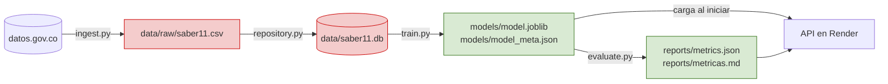

# ADR-003: Almacenamiento y despliegue

- **Estado:** Aceptada
- **Fecha:** 2026-10-29 (despliegue actualizado el 2026-10-31)
- **Autor(es):** Camilo Rivera Quintero

## Contexto
El sistema guarda dos tipos de información con ciclos de vida distintos:

1. **Datos de entrada:** 152.584 filas de resultados Saber 11 (periodo 20224, Bogotá), que corresponden a 76.253 estudiantes únicos porque la fuente trae copias idénticas, con ~20 columnas útiles. Se escriben una vez por periodo y se leen cada vez que se entrena.
2. **Artefactos del modelo:** el `Pipeline` entrenado (preprocesador + clasificador), sus metadatos y las métricas. El entrenamiento los genera y la API los lee al iniciar.

Drivers que condicionan la decisión:
- **Open source**, sin AWS ni servicios de pago (restricción del curso).
- **Evidencia de funcionamiento:** debe poder demostrarse cómo se puso a funcionar el sistema.
- **Reproducibilidad:** cualquier integrante o el profesor debe poder reconstruir todo desde cero con los comandos del README.
- **Idempotencia:** volver a cargar los datos no debe duplicar filas.
- **Rendimiento de la API:** p95 de `POST /predict` < 300 ms. El modelo no puede cargarse en cada petición.
- **Volumen:** el CSV crudo pesa decenas de MB; no debe versionarse en Git.
- **Simplicidad operativa:** seis días de plazo y sin administrador de infraestructura.

## Alternativas consideradas

**Almacenamiento de datos**

| Alternativa | Ventajas | Desventajas |
|---|---|---|
| **SQLite** | Un solo archivo, sin servidor, incluido en Python (`sqlite3`); permite consultas SQL para el EDA; `to_sql(if_exists="replace")` hace la carga idempotente | Una sola escritura a la vez; no apto para muchos usuarios escribiendo a la vez |
| Solo CSV | Lo más simple | Sin consultas; se relee y reinterpreta completo cada vez; tipos frágiles |
| PostgreSQL | Robusto, concurrente, estándar en producción | Requiere instalar y administrar un servidor (o Docker) en los tres computadores |
| Parquet | Columnar, rápido y compacto | Otra dependencia (`pyarrow`); menos familiar para consultas ad hoc |

**Persistencia del modelo**

| Alternativa | Ventajas | Desventajas |
|---|---|---|
| **joblib** (`model.joblib`) + JSON de metadatos | Estándar recomendado por scikit-learn; guarda el `Pipeline` completo, preprocesamiento incluido | Atado a la versión de scikit-learn; cargar un `.joblib` de una fuente no confiable es inseguro |
| pickle | Incluido en Python | Mismos riesgos que joblib y menos eficiente con arreglos grandes |
| ONNX | Portable entre lenguajes | Conversión extra; soporte parcial de transformadores de scikit-learn |
| MLflow Model Registry | Versionado y trazabilidad de experimentos | Infraestructura adicional desproporcionada para el alcance |

**Despliegue**

| Alternativa | Ventajas | Desventajas |
|---|---|---|
| **Local con uvicorn** | Un comando; sin infraestructura; suficiente para demostrar el *product concept* | No queda accesible desde Internet |
| **Render, plan gratuito** | URL pública; sin costo; se configura con un archivo (`render.yaml`) | El servicio no es open source; 512 MB de RAM y 0,1 de CPU; se duerme tras 15 minutos sin tráfico |
| Docker | Entorno reproducible y portable, 100 % open source | Requiere Docker en cada equipo; no da URL pública |
| Hugging Face Spaces (Docker) | 16 GB de RAM | Docker en el hardware gratuito requiere suscripción de pago |

## Criterios / métricas de evaluación
| Criterio | SQLite + joblib + uvicorn local |
|---|---|
| Open source y sin costo | ✅ SQLite (dominio público), joblib (BSD), uvicorn (BSD) |
| Instalación en los tres equipos | ✅ Solo `pip install -r requirements.txt` |
| Reproducibilidad desde cero | ✅ `ingest` → `repository` → `train` regeneran datos y modelo |
| Memoria en el plan gratuito | ✅ La API usa ~175 MB de 512 MB. Entrenar llega a ~960 MB, por eso no se entrena en Render |
| Idempotencia de la carga | ✅ Reemplazo completo de la tabla `resultados` |
| Rendimiento de lectura para entrenar | ✅ ~152.000 filas crudas se leen en segundos |
| Latencia de predicción | ✅ El modelo se carga **una vez** al iniciar la API |

## Decisión
- **Datos:** el CSV crudo se guarda en `data/raw/saber11.csv` y se carga en **SQLite** (`data/saber11.db`, tabla `resultados`). Ninguno de los dos se versiona en Git (`.gitignore`); se regeneran con los scripts. El entrenamiento corre en local.
- **Modelo:** el `Pipeline` completo se guarda con **joblib** en `models/model.joblib`, junto con `models/model_meta.json` (modelo, umbral, variables, fecha, métricas de validación). Ambos **sí** se versionan: pesan pocos KB y son lo que se despliega. Las métricas de test van en `reports/metrics.json`, que también se versiona como evidencia.
- **Despliegue:** la API se publica en **Render, plan gratuito**, definida en `render.yaml`, con las versiones fijas de `requirements-deploy.txt`. También se ejecuta en local con `uvicorn saber11.api.main:app`. En ambos casos carga el modelo una sola vez al arrancar.

*Rojo: se regenera y no se versiona. Verde: se versiona y se despliega o sirve como evidencia.*

## Consecuencias
- **Positivas:**
  - Sin infraestructura propia: la API tiene una URL pública y todo sigue corriendo en el portátil de cualquier integrante o del profesor.
  - La carga de datos es idempotente y el entrenamiento es reproducible (semilla fija y la misma tabla).
  - La API no reentrena ni lee la base de datos: solo usa el artefacto, por eso responde rápido.
  - El repositorio queda liviano: el único binario es el modelo, de unos 10 KB.
  - El despliegue no depende de datos.gov.co: Render no descarga datos ni entrena.
- **Negativas / riesgos / deuda técnica:**
  - SQLite no soporta muchas escrituras concurrentes. Es aceptable porque solo la ingesta escribe.
  - `model.joblib` solo funciona con la misma versión de scikit-learn con la que se entrenó. Por eso `requirements-deploy.txt` fija las versiones y `model_meta.json` registra `sklearn_version`. En otro entorno, se regenera con `train.py`.
  - Cargar un `.joblib` ejecuta código: solo se cargan artefactos generados por el propio pipeline.
  - Render es un servicio propietario. El stack sigue siendo open source y el proyecto puede ejecutarse completo en local, así que no hay dependencia de ese proveedor.
  - En el plan gratuito, la primera petición tras 15 minutos sin tráfico tarda cerca de un minuto y la CPU es limitada: la latencia en la nube debe medirse aparte.
  - La API es pública y no tiene autenticación. Es aceptable porque no guarda consultas ni acepta identificadores.

## Trade-offs
- Se sacrifica **concurrencia y escalabilidad** de la base de datos (PostgreSQL) a cambio de **cero administración** y una instalación idéntica en los tres equipos.
- Se sacrifica **portabilidad del modelo** (ONNX) a cambio de guardar el `Pipeline` completo con una sola línea y sin conversión.
- Se sacrifica **rendimiento y disponibilidad continua** (plan de pago) a cambio de **una URL pública sin costo**, coherente con un *product concept*.
- Se versiona un binario del modelo a cambio de **un despliegue simple** que no entrena ni descarga datos.

## Evolución prevista (hacia un entorno real)
| Hoy | Mañana |
|---|---|
| SQLite local | PostgreSQL gestionado |
| `model.joblib` en disco | Registro de modelos versionado (MLflow) |
| Una instancia gratuita en Render | Contenedor Docker detrás de un balanceador, con varias réplicas sin estado |
| Reentrenamiento manual | Ejecución programada por periodo y monitoreo de métricas y equidad |

## Validación
- Ejecutar `python -m saber11.data.repository` dos veces deja el mismo número de filas (test de idempotencia).
- `python -m saber11.models.train` en un clon nuevo regenera `models/model.joblib` sin pasos manuales.
- La API arranca en local y en Render, `GET /health` informa el modelo cargado y la latencia p95 de `POST /predict` queda medida en las evidencias.
