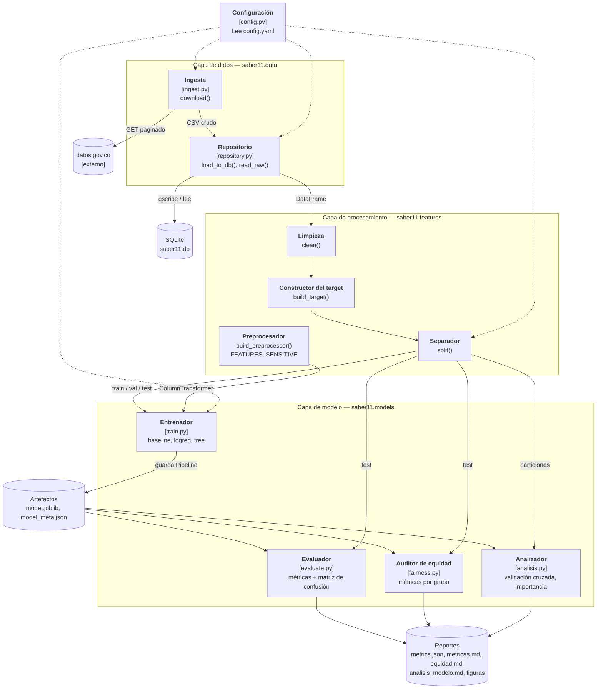
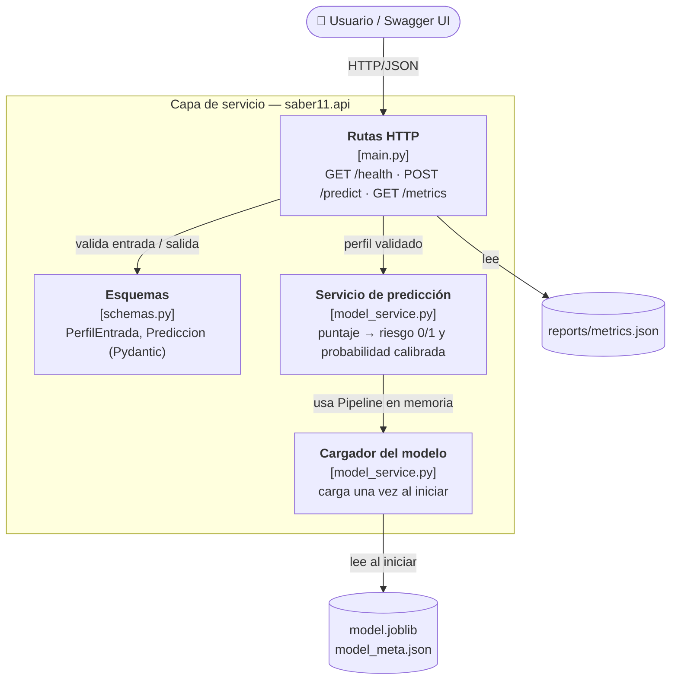

# C4 — Nivel 3: Diagrama de componentes

Muestra los componentes internos de los dos contenedores con lógica propia, **Pipeline de entrenamiento** y **API de predicción**, y cómo se relacionan. Cada componente es un módulo de `src/saber11/`, y sus funciones están definidas en [`contratos.md`](contratos.md).

## 3.1 Pipeline de entrenamiento (capas de datos, procesamiento y modelo)

## 3.2 API de predicción (capa de servicio)

## Responsabilidades y relaciones

| Componente | Módulo | Responsabilidad | Usa a | Responsable |
|---|---|---|---|---|
| Configuración | `config.py` | Cargar parámetros de `config.yaml` | — | Daniel |
| Ingesta | `data/ingest.py` | Descarga paginada, idempotente y con reintentos | Configuración | Daniel |
| Repositorio | `data/repository.py` | Persistir y leer la tabla `resultados` | Configuración | Daniel |
| Limpieza, target, separador, preprocesador | `features/preprocessing.py` | Dejar los datos listos y separados sin fuga | Repositorio | Daniel |
| Entrenador | `models/train.py` | Entrenar, comparar en validación y guardar el mejor `Pipeline` | Procesamiento | Richard |
| Evaluador | `models/evaluate.py` | Métricas en test, matriz de confusión, comparación con baseline | Artefactos, separador | Richard |
| Auditor de equidad | `models/fairness.py` | Métricas por grupo sensible | Artefactos, separador | Richard |
| Analizador | `models/analisis.py` | Validación cruzada e importancia de variables | Artefactos, separador | Camilo |
| Calibración | `calibracion.py` | Convertir el puntaje en probabilidad; lo comparten entrenamiento y API | — | Camilo |
| Rutas HTTP | `api/main.py` | Exponer los endpoints | Esquemas, servicio de predicción | Camilo |
| Esquemas | `api/schemas.py` | Validar la entrada (422 si es inválida) y dar forma a la salida | — | Camilo |
| Cargador y servicio de predicción | `api/model_service.py` | Cargar el modelo una vez y convertir el puntaje en riesgo y probabilidad | Artefactos, Calibración | Camilo |

**Relaciones que NO existen, por diseño:** la API no usa la capa de datos ni la de procesamiento. Solo conoce el `Pipeline` serializado, que ya incluye el preprocesamiento. Si el código importara `saber11.data` desde `saber11.api`, se rompería la arquitectura en capas.
