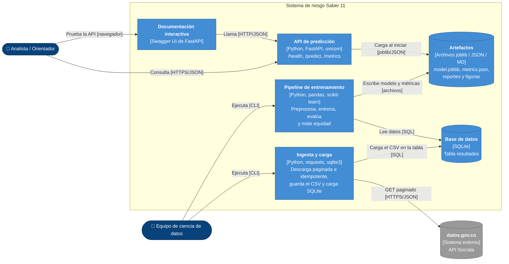

# C4 — Nivel 2: Diagrama de contenedores

Abre la caja del sistema y muestra sus piezas ejecutables o de almacenamiento (contenedores), la tecnología de cada una y cómo se comunican.

| Contenedor | Tecnología | Responsabilidad | Capa | Código |
|---|---|---|---|---|
| Ingesta y carga | Python, requests, sqlite3 | Descarga los resultados del periodo y la región configurados a un CSV y los carga en SQLite. Re-ejecutarla no duplica datos. | Datos | `src/saber11/data/ingest.py`, `src/saber11/data/repository.py` |
| Base de datos | SQLite | Guarda los datos crudos en la tabla `resultados`. | Datos | `data/saber11.db` |
| Pipeline de entrenamiento | Python, pandas, scikit-learn | Limpia, construye el target, separa los datos, entrena, evalúa y calcula métricas por grupo. | Procesamiento y modelo | `src/saber11/features/`, `src/saber11/models/` |
| Artefactos | joblib, JSON, Markdown, PNG | Modelo entrenado, métricas y reportes. Son el contrato entre el entrenamiento y la API. | Modelo | `models/`, `reports/` |
| API de predicción | Python, FastAPI, uvicorn (publicada en Render) | Valida la entrada, predice con el modelo cargado en memoria y expone las métricas. | Servicio | `src/saber11/api/main.py` |
| Documentación interactiva | Swagger UI (incluida en FastAPI) | Permite probar la API desde el navegador sin escribir código. | Presentación | `/docs` |

**Decisiones relacionadas:** [ADR-001](../adr/0001-lenguaje-framework-estilo.md) (Python, FastAPI y capas) y ADR-003 (almacenamiento y despliegue).
