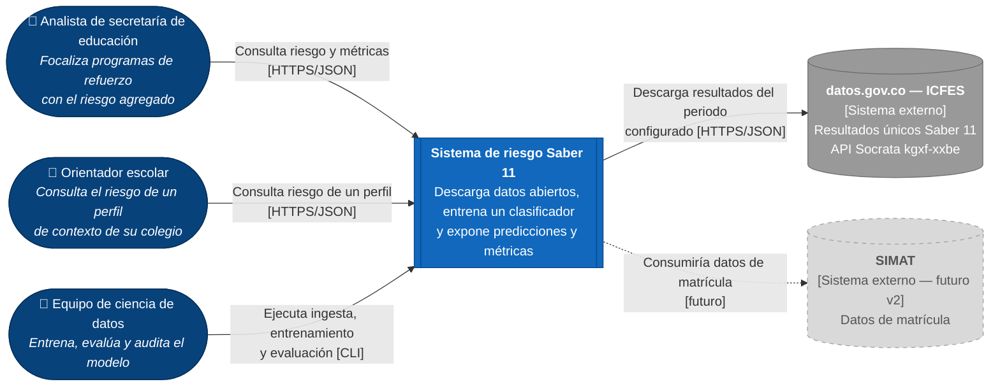

# C4 — Nivel 1: Diagrama de contexto

Muestra el sistema como una sola caja, quién lo usa y con qué sistemas externos se comunica. No muestra tecnologías ni detalles internos.

| Elemento | Tipo | Responsabilidad |
|---|---|---|
| Analista de secretaría de educación | Persona | Usa el riesgo agregado por colegio o localidad para decidir dónde asignar programas de refuerzo. |
| Orientador escolar | Persona | Consulta el nivel de riesgo de perfiles de contexto de su institución para planear acompañamiento. |
| Equipo de ciencia de datos | Persona | Ejecuta el pipeline, revisa métricas y equidad, y reentrena cuando cambian los datos. |
| Sistema de riesgo Saber 11 | Sistema (este proyecto) | Obtiene y almacena los datos, entrena y evalúa el modelo, y expone predicciones y métricas por API. |
| datos.gov.co (ICFES) | Sistema externo | Fuente oficial y abierta de los resultados de Saber 11. |
| SIMAT | Sistema externo futuro | Fuente de matrícula para una versión 2. Está **fuera del alcance** actual (gris y punteado). |
