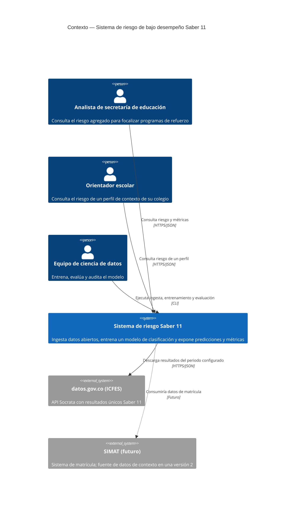

# C4 — Nivel 1: Diagrama de contexto (borrador)

**Lectura:** el sistema se ve como una sola caja. Los elementos en gris representan integraciones futuras fuera del alcance actual.

TODO (Camilo): validar actores con los user persona y agregar el diagrama de contenedores en `c4-contenedores.md`.
