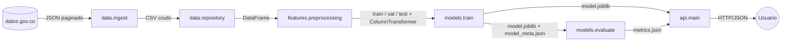

# Contratos entre capas

Interfaces que cada capa expone a la siguiente. Permiten que cada integrante trabaje en su capa en paralelo y que el código coincida con la arquitectura documentada. Cualquier cambio a un contrato se acuerda en el grupo y se actualiza aquí.



## Configuración — `saber11/config.py` (Daniel)
```python
load_config(path: str = "config/config.yaml") -> dict
```

## Capa de datos — `saber11/data/` (Daniel)
```python
# ingest.py
download(cfg: dict, force: bool = False) -> pathlib.Path
#   Descarga paginada ($limit/$offset) filtrando por cfg["data"]["periodo"] y
#   cfg["data"]["cole_depto_ubicacion"]. Escribe cfg["data"]["raw_path"].
#   Idempotente: si el archivo existe y force=False, no vuelve a descargar.
#   CLI: python -m saber11.data.ingest [--force]

# repository.py
load_to_db(cfg: dict) -> int          # CSV crudo -> tabla "resultados" en SQLite (reemplaza). Devuelve n filas.
read_raw(cfg: dict) -> pd.DataFrame   # Lee la tabla "resultados".
#   CLI: python -m saber11.data.repository
```

## Capa de procesamiento — `saber11/features/preprocessing.py` (Daniel)
```python
TARGET: str = "riesgo_bajo_desempeno"
FEATURES: list[str]       # Solo variables previas a la prueba (cole_*, fami_*, estu_genero, edad).
SENSITIVE: list[str] = ["estu_genero", "fami_estratovivienda", "cole_naturaleza", "cole_area_ubicacion"]
LEAKAGE_PREFIXES: tuple = ("punt_", "desemp_", "percentil_")   # Nunca son entrada del modelo.

clean(df: pd.DataFrame) -> pd.DataFrame
build_target(df: pd.DataFrame, percentile: int) -> tuple[pd.DataFrame, float]   # (df con TARGET, umbral de punt_global)
split(df: pd.DataFrame, cfg: dict) -> tuple[pd.DataFrame, pd.DataFrame, pd.DataFrame]   # train, val, test estratificados
build_preprocessor(features: list[str] = FEATURES) -> sklearn.compose.ColumnTransformer
```

## Capa de modelo — `saber11/models/` (Richard)
```python
# train.py — CLI: python -m saber11.models.train
#   Entrena baseline (DummyClassifier), LogisticRegression y DecisionTreeClassifier.
#   Selecciona por F1 de la clase 1 en validación.
#   Guarda:
#     models/model.joblib     -> sklearn Pipeline([("prep", ColumnTransformer), ("clf", estimador)])
#     models/model_meta.json  -> {"model_name", "threshold_punt_global", "features", "trained_at", "metrics_val"}

# evaluate.py — CLI: python -m saber11.models.evaluate
#   Evalúa en test el modelo seleccionado y el baseline.
#   Guarda reports/metrics.json, reports/metricas.md y reports/figures/matriz_confusion.png

# fairness.py — CLI: python -m saber11.models.fairness
#   Métricas por cada grupo de SENSITIVE -> reports/equidad.md y reports/equidad.csv
```

`reports/metrics.json`:
```json
{
  "selected_model": "logreg",
  "test": {
    "baseline": {"accuracy": 0.0, "precision": 0.0, "recall": 0.0, "f1": 0.0, "roc_auc": 0.0},
    "logreg":   {"accuracy": 0.0, "precision": 0.0, "recall": 0.0, "f1": 0.0, "roc_auc": 0.0},
    "tree":     {"accuracy": 0.0, "precision": 0.0, "recall": 0.0, "f1": 0.0, "roc_auc": 0.0}
  },
  "confusion_matrix": [[0, 0], [0, 0]]
}
```

## Capa de servicio — `saber11/api/main.py` (Camilo)
Carga `models/model.joblib` una sola vez al iniciar y expone:

| Método | Ruta | Entrada | Salida |
|---|---|---|---|
| GET | `/health` | — | `{"status": "ok", "model": "<model_name>"}` |
| POST | `/predict` | JSON con las columnas de `FEATURES` | `{"riesgo": 0/1, "probabilidad": float}` |
| GET | `/metrics` | — | Contenido de `reports/metrics.json` |
